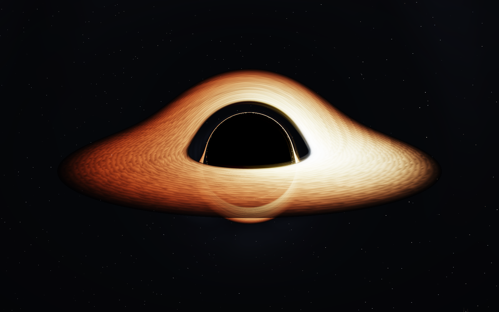
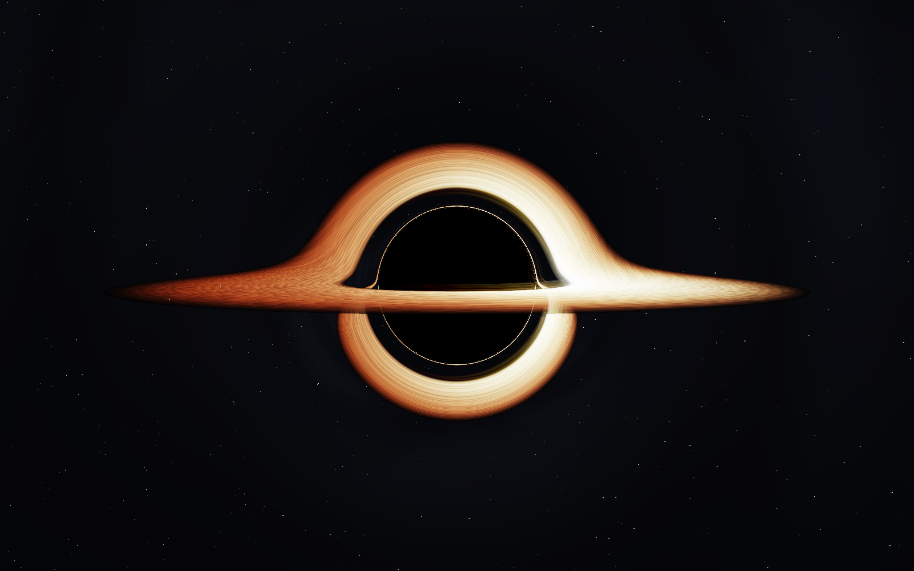
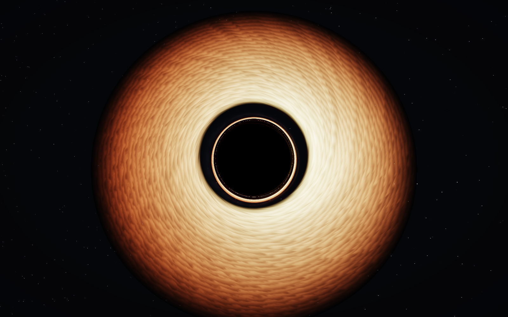
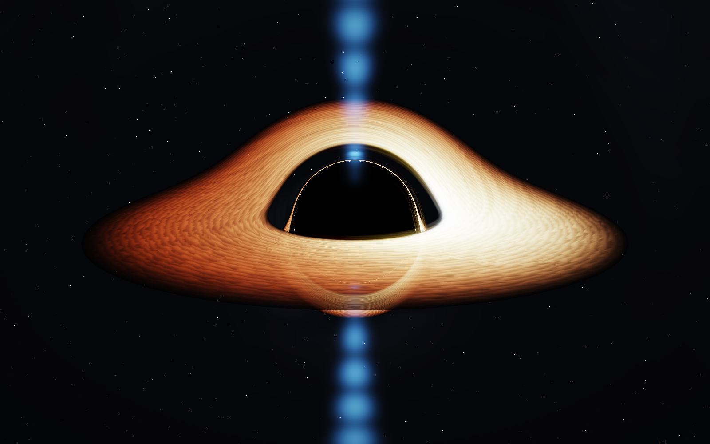
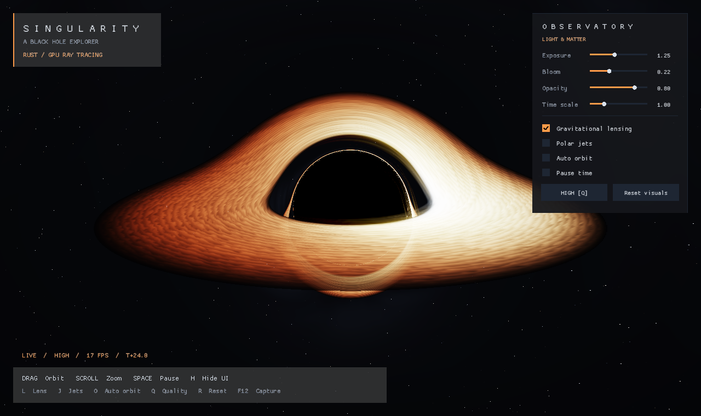

<div align="center">

# SINGULARITY

**An interactive black hole explorer, written in Rust.**

GPU ray tracing · Curved light paths · A procedural accretion disk

[](https://github.com/funlifew/singularity-blackhole-3d-rust/actions/workflows/ci.yml)
[](https://github.com/funlifew/singularity-blackhole-3d-rust/releases/latest)
[](https://www.rust-lang.org/)
[](LICENSE)

[Download](https://github.com/funlifew/singularity-blackhole-3d-rust/releases/latest) · [Get started](#run-from-source) · [Controls](#controls) · [Rendering](#how-it-renders) · [Contribute](CONTRIBUTING.md)



</div>

Orbit a dark gravitational well and watch the far side of its accretion disk fold into view. Singularity traces curved rays through a three-dimensional scene, combining a turbulent disk, asymmetric emission, lensed starlight, and optional blue polar jets in a small, self-contained desktop application.

This is a **real-time visual approximation inspired by Schwarzschild optics**, designed for exploration and graphics experimentation. It is not a validated astrophysical solver.

## Features

- **Curved-ray rendering.** A GPU integration pass produces the central shadow, secondary disk images, and strongly deflected background stars.
- **An animated accretion disk.** Differential orbital motion, procedural turbulence, radial temperature falloff, and approximate Doppler and gravitational shifts give the disk structure and a brighter approaching side.
- **A cinematic finish.** HDR encoding, exposure, a screen-space bloom approximation, tone mapping, and a subtle vignette.
- **An orbitable 3D scene.** Smooth mouse controls, exponential zoom, automatic orbiting, and four camera presets.
- **Adjustable rendering cost.** Three quality levels change both render resolution and ray integration budget.
- **Reproducible captures.** Freeze simulation time, choose a camera preset, export a PNG, and exit from the command line.
- **Embedded shaders.** No texture downloads, asset folders, or network connection are required at runtime.

## Gallery

All images below are captured from the application using the committed GLSL shaders. No generated concept art or offline replacement renderer is used.

| Edge-on view | Looking down on the disk |
| --- | --- |
|  |  |

| Polar jets | Observatory controls |
| --- | --- |
|  |  |

## Download

Get the latest desktop build from [GitHub Releases](https://github.com/funlifew/singularity-blackhole-3d-rust/releases/latest). Extract the archive and launch `singularity-rust` (`singularity-rust.exe` on Windows).

| Platform | Archive target |
| --- | --- |
| Linux x86-64 | `x86_64-unknown-linux-gnu.tar.gz` |
| Windows x86-64 | `x86_64-pc-windows-msvc.zip` |
| macOS Apple Silicon | `aarch64-apple-darwin.tar.gz` |
| macOS Intel | `x86_64-apple-darwin.tar.gz` |

The table lists the automated build targets; available downloads are listed on each release page. Each archive also includes the license, README, and changelog. `SHA256SUMS` is published with every release. Desktop builds require an OpenGL-capable graphics driver; Linux also requires X11. macOS builds use the OpenGL backend and are distributed as command-line executables.

## Run from source

Install the current stable [Rust toolchain](https://rustup.rs/), then:

```bash
git clone https://github.com/funlifew/singularity-blackhole-3d-rust.git
cd singularity-blackhole-3d-rust
cargo run --release --locked
```

On Ubuntu/Debian, install the graphics runtime if it is missing:

```bash
sudo apt-get install libx11-6 libxi6 libgl1
```

Use `--release` for interactive rendering. The first build downloads dependencies; the application itself runs offline.

## Controls

| Input | Action |
| --- | --- |
| Left mouse drag | Orbit the camera |
| Scroll wheel | Zoom in or out |
| `Space` | Pause or resume disk animation |
| `H` | Hide or show the entire interface |
| `L` | Toggle light bending |
| `J` | Toggle polar jets |
| `O` | Toggle automatic camera orbit |
| `Q` | Cycle low → medium → high quality |
| `R` | Restore the launch camera preset and simulation time |
| `F12` | Save a PNG in `screenshots/` (desktop) |
| `Esc` | Exit |

The observatory panel adjusts exposure, bloom, disk opacity, time scale, and visual toggles. Pausing freezes the simulation while leaving the camera interactive. **Reset visual settings** restores the panel defaults; `R` restores the camera.

### Quality settings

| Quality | Resolution scale per axis | Maximum ray steps |
| --- | --- | --- |
| Low | 50% | 150 |
| Medium (default) | 75% | 210 |
| High | 100% | 260 |

Performance depends on the GPU, viewport size, viewing angle, and enabled effects. Start with low quality on integrated graphics. Reduced quality uses larger integration steps, so fine rings and star details can change between levels.

## Command-line examples

```bash
# A clean, edge-on view
cargo run --release --locked -- --preset edge-on --no-ui

# Polar jets at full resolution
cargo run --release --locked -- --preset jets --quality high

# A deterministic PNG: capture mode freezes time at T+24
cargo run --release --locked -- --preset cinematic --quality high \
  --time 24 --width 1600 --height 1000 --no-ui --capture screenshots/black-hole.png

# Compare the scene with straight light paths
cargo run --release --locked -- --no-lensing

# All options
cargo run --release --locked -- --help
```

Presets: `cinematic`, `edge-on`, `top-down`, and `jets`. `--frames N` controls how many frames are drawn before a capture exits (default: 3). Capturing requires a working graphics context, even when the interface is hidden.

Regenerate the four clean gallery views with:

```bash
bash scripts/capture.sh
```

On a headless Linux machine, install `xvfb`, `xauth`, and Mesa, then run the script through `xvfb-run -a`. Curated documentation images are tracked in `docs/screenshots/`; personal captures in `screenshots/` are ignored by Git.

## How it renders

1. **Camera rays.** The orbit camera supplies an orthonormal basis. Each pixel launches a ray through a 45-degree vertical field of view.
2. **Light bending.** A velocity-Verlet-style integrator advances the ray under a Schwarzschild-inspired central force. Step size decreases near the black hole. Rays crossing the unit horizon are absorbed.
3. **Disk intersections.** Crossings of the equatorial plane sample an emitting disk between radii 3 and 10. Multiple crossings contribute through front-to-back opacity accumulation, revealing secondary images.
4. **Emission and sky.** Radial heat, differential rotation, procedural noise, and approximate frequency shifts color the disk. Escaping rays sample a directional starfield; optional jets add stylized emission along the polar axis.
5. **Post-processing.** Radiance is encoded into a render texture, decoded in a second pass, and combined with bloom, exposure, tone mapping, and display gamma.

### Physical scope

Lengths use normalized units with the horizon radius set to 1. The disk's inner edge is set to 3, inspired by the innermost stable circular orbit of a nonrotating black hole. The integrator uses a finite step budget and approximate observer initial conditions; the temperature palette and opacity model are artistic. Bloom is a compact sampling approximation rather than a full multiscale optical effect.

There is no Kerr spin, frame dragging, fluid simulation, spectral radiative transfer, or physically modeled jet launching. Treat the output as an interactive visualization, not a tool for scientific measurement.

## Project layout

```text
src/
  main.rs                 Application loop and capture handling
  camera.rs               Orbit controls and camera basis
  settings.rs             Visual settings and quality levels
  options.rs              Validated CLI options and presets
  renderer.rs             GPU materials, render targets, post pass
  gui.rs                  HUD and observatory controls
  shaders/
    fullscreen.vert       Shared full-screen vertex shader
    blackhole.frag        Ray integration, disk, sky, and jets
    post.frag             HDR decode, bloom, and tone mapping
scripts/
  capture.sh              Reproduce the gallery
  check_capture.py        Detect empty or broken render captures
  package.py              Assemble desktop release archives
```

## Development and automation

```bash
cargo fmt --all -- --check
cargo clippy --locked --all-targets -- -D warnings
cargo test --locked
cargo build --release --locked
```

[GitHub Actions](https://github.com/funlifew/singularity-blackhole-3d-rust/actions) runs formatting, strict linting, unit tests, a WebAssembly compile/lint check, native desktop builds, and a Mesa/Xvfb render smoke test. The render job actually compiles the GLSL shaders and exports images for inspection. WebAssembly is compile-checked; a hosted browser distribution is not included.

On `main`, publication runs only after all checks and all four desktop builds succeed. If the version in `Cargo.toml` has no release yet, the workflow creates its tag at the checked commit and publishes archives plus SHA-256 checksums. Existing releases are left unchanged. To ship another version, update the manifest, lockfile, and changelog together. See [CONTRIBUTING.md](CONTRIBUTING.md).

## License

[MIT](LICENSE) © 2026 Mehdi Radfar.

Built with [Macroquad](https://github.com/not-fl3/macroquad) and [Miniquad](https://github.com/not-fl3/miniquad).
